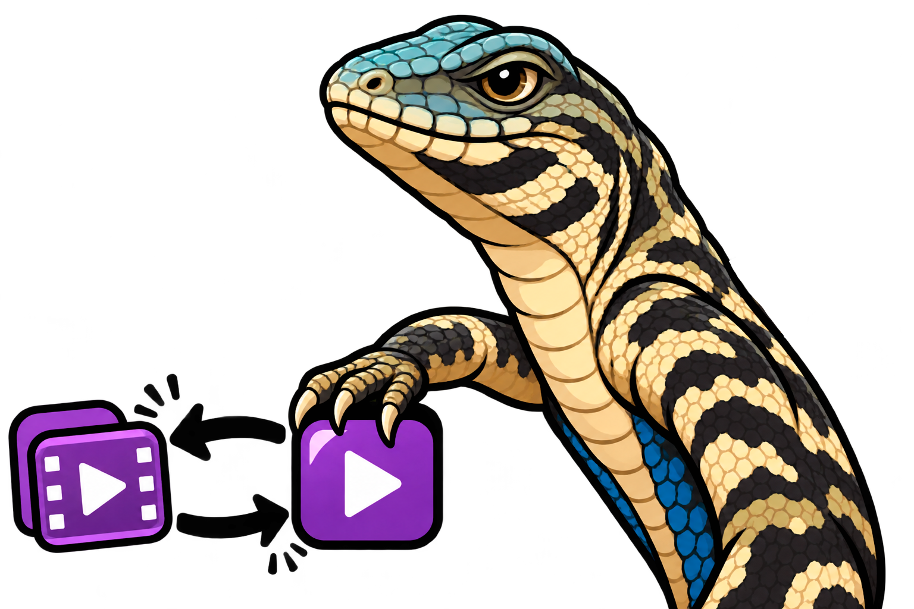

<p align="center">
  <picture>
    <source media="(prefers-color-scheme: dark)" srcset="resources/logo_dark.png">
    
  </picture>
  <picture>
    <source media="(prefers-color-scheme: dark)" srcset="resources/name_dark.png">
    
  </picture>
</p>

# Lizard

**Português** · [English](README_en.md)

[](https://www.python.org/)
[](https://ffmpeg.org/)
[](https://ffmpeg.org/ffprobe.html)
[](https://www.riverbankcomputing.com/software/pyqt/)

**Índice**

- [O que é o Lizard](#o-que-é-o-lizard)
- [Da mídia original ao novo arquivo](#da-mídia-original-ao-novo-arquivo)
- [Comece a converter](#comece-a-converter)
- [Requisitos e ferramentas](#requisitos-e-ferramentas)
- [Código e estrutura](#código-e-estrutura)
  - [Como a conversão funciona](#como-a-conversão-funciona)
  - [Executar pelo código-fonte](#executar-pelo-código-fonte)
  - [Gerar o pacote portátil](#gerar-o-pacote-portátil)
- [Recursos do Lizard](#recursos-do-lizard)
- [Antes de converter](#antes-de-converter)
- [Licença e contribuições](#licença-e-contribuições)

## O que é o Lizard

O Lizard é um aplicativo de desktop para converter arquivos de áudio e vídeo no Windows. Use-o para preparar uma mídia em outro formato, extrair o som de um vídeo ou trocar o contêiner preservando as faixas que puderem ser copiadas. Você escolhe a entrada, o formato de saída e onde gravar o resultado.

## Da mídia original ao novo arquivo

Os perfis de saída incluem MP4, MKV e WebM para vídeo, além de MP3, WAV, FLAC e Opus para áudio. Um perfil combina a extensão do arquivo com as opções de áudio e vídeo que o aplicativo considera para aquele destino.

O Lizard inspeciona as faixas da entrada e avalia a cópia para cada faixa selecionada. Quando a cópia funciona, a mídia mantém sua codificação original. Quando é preciso recodificar, o aplicativo usa um encoder do perfil. Assim, uma troca de contêiner pode preservar uma faixa e recodificar outra na mesma operação.

## Comece a converter

1. Extraia a pasta portátil `lizard-converter-<versão>` para um local com permissão de gravação e abra `Lizard.exe`.
2. Arraste a mídia para a janela ou selecione **Arquivo → Abrir**. O nome exibido na janela identifica o arquivo carregado.
3. Escolha **Vídeo** ou **Áudio** em **Tipo de saída**. O seletor **Formato de saída** lista os formatos desse tipo. Para extrair áudio de um MP4, escolha **Áudio → MP3**.
4. Clique em **Converter** e escolha um novo nome de arquivo. Quando a janela **Faixas de saída** aparecer, revise as faixas e os avisos e clique em **Continuar**. O progresso mostra a etapa e o tempo decorrido. Use **Cancelar** para interromper a operação.
5. Após a confirmação, abra o arquivo no destino escolhido. No exemplo do MP3, o resultado contém apenas a faixa de áudio.

Ao mover o aplicativo para outro local, leve a pasta portátil inteira. O executável usa os catálogos, as bibliotecas e as ferramentas que ficam nas pastas ao seu lado.

## Requisitos e ferramentas

| Ambiente | O que você precisa |
| --- | --- |
| Pacote portátil | Windows x64, a pasta completa do aplicativo e acesso de gravação à pasta de saída. Python, Qt, FFmpeg e FFprobe já acompanham o pacote. |
| Execução pelo código-fonte | Python 3.13 ou superior, PyQt6 e os executáveis `tools/ffmpeg/ffmpeg.exe` e `tools/ffmpeg/ffprobe.exe` no Windows. |
| Empacotamento | Python x64 no Windows, PyQt6, PyInstaller e os binários conferidos pelos hashes registrados pelo projeto. |

O PyQt6 fornece a interface gráfica. O FFprobe identifica as faixas, os tipos de mídia e os codecs. O FFmpeg lê o arquivo e gera a saída. O PyInstaller reúne o runtime e as dependências no pacote Windows e só é necessário para gerar esse pacote.

Na execução pelo código-fonte, coloque os executáveis e as DLLs em `tools/ffmpeg/` na raiz do projeto. No pacote portátil, `tools/ffmpeg/` fica sob a pasta que contém `Lizard.exe`. Para preparar um build, use os binários cujos hashes correspondem ao registro do projeto. [Origem do FFmpeg e do FFprobe](tools/ffmpeg/ORIGEM.md)

## Código e estrutura

| Caminho | Responsabilidade |
| --- | --- |
| [`main.py`](main.py) | Inicializa a janela e resolve os caminhos dos recursos e das preferências. |
| [`interface/`](interface/) | Componentes, textos, temas e controlador que conecta a janela ao serviço. |
| [`services/`](services/) | Carregamento dos catálogos, inspeção, planejamento, conversão e validação da saída. |
| [`data/formatos/`](data/formatos/) | Perfis de áudio e vídeo em JSON, com extensões e codecs candidatos. |
| [`resources/`](resources/) | Marca, ícones dos temas e tipos de saída, e ícone do executável. |
| [`tools/`](tools/) | Executáveis de mídia e informações de origem e licença. |
| [`scripts/`](scripts/) e [`tests/`](tests/) | Empacotamento para Windows e verificações do aplicativo. |

### Como a conversão funciona

1. O controlador reúne a entrada, o perfil escolhido e o destino e chama o serviço em uma thread de trabalho. A janela recebe atualizações de etapa enquanto a tarefa roda.
2. O serviço consulta o FFprobe, disponibiliza as faixas elegíveis para revisão e mapeia as faixas selecionadas. Os catálogos indicam candidatos à cópia. O serviço testa a compatibilidade no contêiner de destino e monta os argumentos por faixa.
3. O FFmpeg escreve em um diretório temporário dentro da pasta de saída. O serviço usa o FFprobe para conferir a quantidade, os tipos e os codecs das faixas, além dos canais e da duração do áudio quando disponíveis. Só então disponibiliza o arquivo no caminho escolhido.

### Executar pelo código-fonte

Na raiz do projeto, prepare os binários e DLLs em `tools/ffmpeg/` conforme o registro de origem. Use o PowerShell para criar o ambiente e abrir o aplicativo. [Origem dos binários](tools/ffmpeg/ORIGEM.md)

```powershell
python -m venv .venv
.\.venv\Scripts\python.exe -m pip install "PyQt6>=6.8,<7"
.\.venv\Scripts\python.exe main.py
```

### Gerar o pacote portátil

```powershell
.\.venv\Scripts\python.exe -m pip install PyInstaller
.\.venv\Scripts\python.exe scripts/compilar.py
```

Após verificar os requisitos, o script pede a versão. Para informar a versão na linha de comando, use `--versao "0.9 beta1"`. O executável fica em `dist/release/lizard-converter-<versão>/Lizard.exe`. O script `scripts/beta.py` usa o mesmo fluxo e grava em `dist/beta/`.

O script confere os hashes dos binários, testa a inicialização e reúne as dependências em `lib/`. Os catálogos, as ferramentas e os recursos visuais ficam em `data/`, `tools/` e `resources/`, respectivamente. Os avisos de licença ficam em `license/`. Se o PyInstaller falhar, o script informa o caminho do log no diretório do canal.

## Recursos do Lizard

- **Conversão de áudio e vídeo.** Escolha o perfil conforme o tipo de saída desejado, como FLAC para um arquivo de áudio ou MKV para um arquivo com vídeo.
- **Extração de áudio.** Escolha um perfil de áudio para uma entrada de vídeo. As faixas sonoras aplicáveis seguem para a saída sem a imagem.
- **Processamento por faixa.** A cópia evita uma nova etapa de codificação quando o destino aceita a faixa. A recodificação usa o encoder definido no perfil para produzir mídia adequada ao destino.
- **Progresso e cancelamento.** A janela de progresso acompanha a inspeção, a preparação, a conversão e a verificação. O cancelamento interrompe o trabalho antes de concluir a entrega.
- **Temas claro e escuro.** Use os botões de sol e lua para trocar a aparência. No pacote portátil, a escolha do último fechamento é restaurada ao abrir o aplicativo.

## Antes de converter

Escolha uma pasta gravável com espaço para a saída e os arquivos temporários da conversão. O aplicativo exige um novo caminho de saída e preserva a entrada. O tamanho final depende da mídia, do destino e das faixas que precisarem ser recodificadas.

O destino define quantas faixas cabem no arquivo. Se você escolher MP3 para uma entrada com vários áudios, selecione uma faixa. Para preservar várias, use um formato compatível, como MKV para vídeo ou MKA para áudio. A revisão de faixas informa quando legendas, capas ou anexos ficarão fora do resultado.

O processamento de mídia ocorre no computador. No pacote portátil, a preferência de tema é gravada em `data/preferences.json` no fechamento normal. Para preservar essa escolha ao mover a pasta do aplicativo, leve o arquivo de preferências junto. Em instalações Windows, cada usuário tem sua preferência em `%LOCALAPPDATA%\LizardConverter\preferences.json`.

## Licença e contribuições

O código e a documentação do LizardConverter são disponibilizados sob a **Licença MIT**. Ela permite usar, modificar e redistribuir o material, desde que o aviso de copyright e o texto da licença sejam mantidos nas cópias ou partes substanciais. [Licença do projeto](LICENSE) · [Texto da Licença MIT](https://opensource.org/license/mit)

Os componentes de terceiros seguem seus próprios termos. A build de FFmpeg e FFprobe usada no projeto acompanha a LGPLv3. Os ícones de sol e lua acompanham a licença Lucide. Os avisos coletados do PyQt6 e de suas dependências ficam em `license/` no pacote portátil. [Licença dos binários](tools/ffmpeg/COPYING.LGPLv3) · [Licença dos ícones](resources/LICENSE-Lucide.txt) · [Licenciamento do PyQt](https://www.riverbankcomputing.com/software/pyqt/)

Para contribuir, envie uma pull request com o objetivo da mudança e os passos para verificá-la. Se a alteração afetar a conversão, inclua os formatos de entrada e saída usados no teste e uma amostra que possa ser compartilhada. Se afetar a documentação, revise as duas versões do README. Rode a suíte na raiz do projeto antes de enviar.

```powershell
.\.venv\Scripts\python.exe -B -m unittest discover -s tests -v
```

Os testes de conversão real usam os executáveis locais e são pulados quando eles estão ausentes. Use mídias de teste que você possa compartilhar.
