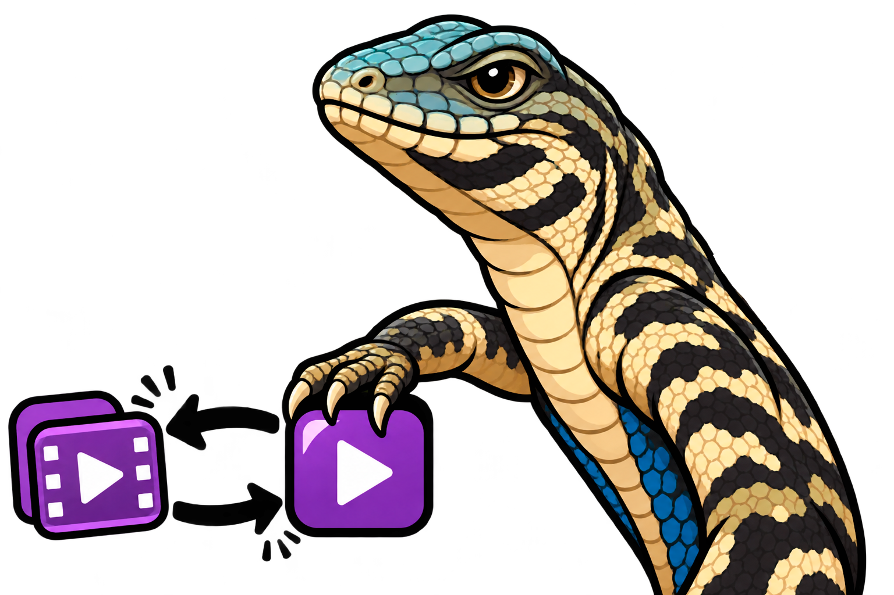

<p align="center">
  <picture>
    <source media="(prefers-color-scheme: dark)" srcset="resources/logo_dark.png">
    
  </picture>
  <picture>
    <source media="(prefers-color-scheme: dark)" srcset="resources/name_dark.png">
    
  </picture>
</p>

# Lizard

[Português](README.md) · **English**

[](https://www.python.org/)
[](https://ffmpeg.org/)
[](https://ffmpeg.org/ffprobe.html)
[](https://www.riverbankcomputing.com/software/pyqt/)

**Table of contents**

- [What Lizard does](#what-lizard-does)
- [From source media to a new file](#from-source-media-to-a-new-file)
- [Quick start](#quick-start)
- [Requirements and tools](#requirements-and-tools)
- [Code and structure](#code-and-structure)
  - [How conversion works](#how-conversion-works)
  - [Run from source](#run-from-source)
  - [Build the portable package](#build-the-portable-package)
- [Lizard features](#lizard-features)
- [Before converting](#before-converting)
- [License and contributions](#license-and-contributions)

## What Lizard does

Lizard is a Windows desktop app for converting audio and video files. Use it to prepare media in another format, extract sound from a video, or change containers while keeping the streams that can be copied. You choose the input, the output format, and where to save the result.

## From source media to a new file

Output profiles include MP4, MKV, and WebM for video and MP3, WAV, FLAC, and Opus for audio. A profile pairs a file extension with the audio and video options the app considers for that destination.

Lizard inspects the input streams and evaluates whether each selected stream can be copied. A successful copy preserves the original encoding. When re-encoding is needed, the app uses an encoder defined by the profile. A container change can therefore preserve one stream and re-encode another in the same operation.

## Quick start

1. Extract the portable `LizardConverter` folder to a writable location and open `Lizard.exe`.
2. Drag a media file into the window or choose **Arquivo → Abrir** (File → Open). The name displayed in the window identifies the loaded file.
3. Choose an output format in **Formato de saída**. To extract audio from an MP4 with a single audio stream, select **Audio — MP3**. Choose a video profile to keep the video.
4. Click **Converter** (Convert) and choose a file name that does not already exist. The progress window shows the current stage and elapsed time. Use **Cancelar** (Cancel) to stop the operation.
5. After the app confirms completion, open the file at the selected destination. In the MP3 example, the result contains only the audio stream.

Move the entire `LizardConverter` folder when relocating the app. The executable uses the catalogs, libraries, and tools in the folders next to it.

## Requirements and tools

| Environment | What you need |
| --- | --- |
| Portable package | Windows x64, the complete app folder, and write access to the output folder. Python, Qt, FFmpeg, and FFprobe are included. |
| Running from source | Python 3.13 or later, PyQt6, and the `tools/ffmpeg.exe` and `tools/ffprobe.exe` executables on Windows. |
| Packaging | Python x64 on Windows, PyQt6, PyInstaller, and the binaries that match the hashes recorded by the project. |

PyQt6 provides the graphical interface. FFprobe identifies streams, media types, and codecs. FFmpeg reads the file and generates the output. PyInstaller bundles the runtime and dependencies into the Windows package and is only needed when building that package.

When running from source, place the executables in `tools/` at the project root. In the portable package, this folder is next to `Lizard.exe`. To prepare a build, use binaries whose hashes match the project record. [FFmpeg and FFprobe provenance](tools/ORIGEM.md)

## Code and structure

| Path | Responsibility |
| --- | --- |
| [`main.py`](main.py) | Starts the window and resolves paths for resources and preferences. |
| [`interface/`](interface/) | Components, text, themes, and the controller that connects the window to the service. |
| [`services/`](services/) | Catalog loading, inspection, planning, conversion, and output validation. |
| [`data/formatos/`](data/formatos/) | JSON profiles for audio and video with extensions and candidate codecs. |
| [`resources/`](resources/) | Branding, theme icons, and the executable icon. |
| [`tools/`](tools/) | Media executables and their provenance and license information. |
| [`scripts/`](scripts/) and [`tests/`](tests/) | Windows packaging and application tests. |

### How conversion works

1. The controller gathers the input, selected profile, and destination and calls the service in a worker thread. The window receives stage updates while the task runs.
2. The service queries FFprobe and maps the applicable streams. The catalogs identify candidates for copying. The service tests compatibility with the destination container and builds the copy or re-encoding arguments for each stream.
3. FFmpeg writes to a temporary directory inside the output folder. The service uses FFprobe to check stream counts, stream types, and the codecs of copied streams. It then makes the file available at the selected path.

### Run from source

At the project root, prepare the binaries in `tools/` according to the provenance record. Use PowerShell to create the environment and open the app. [Binary provenance](tools/ORIGEM.md)

```powershell
python -m venv .venv
.\.venv\Scripts\python.exe -m pip install "PyQt6>=6.8,<7"
.\.venv\Scripts\python.exe main.py
```

### Build the portable package

```powershell
.\.venv\Scripts\python.exe -m pip install PyInstaller
.\.venv\Scripts\python.exe scripts/compilar.py
```

With the default label, the executable is at `dist/producao/build-local-win64/LizardConverter/Lizard.exe`. The script verifies the binary hashes, tests startup, and collects dependencies in `lib/`. The catalogs, tools, and visual assets go in `data/`, `tools/`, and `resources/`, respectively. License notices collected by the build script go in `license/`.

## Lizard features

- **Audio and video conversion.** Choose a profile for the output you want, such as FLAC for an audio file or MKV for a file with video.
- **Audio extraction.** Choose an audio profile for a video input. The applicable audio streams go into the output without the picture.
- **Per-stream processing.** Copying avoids another encoding step when the destination accepts the stream. Re-encoding uses the encoder defined by the profile to produce media suited to the destination.
- **Progress and cancellation.** The progress window tracks inspection, preparation, conversion, and verification. Canceling stops the work before the output is finalized.
- **Light and dark themes.** Use the sun and moon buttons to change the appearance. The portable package restores the theme saved when the app was last closed.

## Before converting

Choose a writable folder with room for both the output and temporary conversion files. The app requires a new output path and preserves the input. The final file size depends on the media, destination, and streams that need to be re-encoded.

The destination also determines how many streams the file can hold. For an input with multiple audio streams, use a suitable profile such as MKV for video or MKA for audio. Automatic selection includes the audio and video streams applicable to the profile. It leaves out subtitles, attached cover art, and other attachments.

Media processing takes place on your computer. In the portable package, the theme preference is written to `data/preferences.json` when the app closes normally. To keep that choice when moving the app folder, take the preferences file with it.

## License and contributions

The LizardConverter code and documentation are available under the **MIT License**. It allows use, modification, and redistribution as long as the copyright notice and license text are retained in copies or substantial portions. [Project license](LICENSE) · [MIT License text](https://opensource.org/license/mit)

Third-party components follow their own terms. The FFmpeg and FFprobe build used by the project comes with the GPLv3. The sun and moon icons come with the Lucide license. Notices collected for PyQt6 and its dependencies are in `license/` in the portable package. [Binary license](tools/LICENSE) · [Icon license](resources/LICENSE-Lucide.txt) · [PyQt licensing](https://www.riverbankcomputing.com/software/pyqt/)

To contribute, submit a pull request describing the purpose of the change and how to verify it. For conversion changes, include the input and output formats used in testing and a sample you can share. For documentation changes, review both README versions. Run the test suite from the project root before submitting.

```powershell
.\.venv\Scripts\python.exe -B -m unittest discover -s tests -v
```

Tests that perform real conversions use the local executables and are skipped when those executables are missing. Use test media that you can share.
